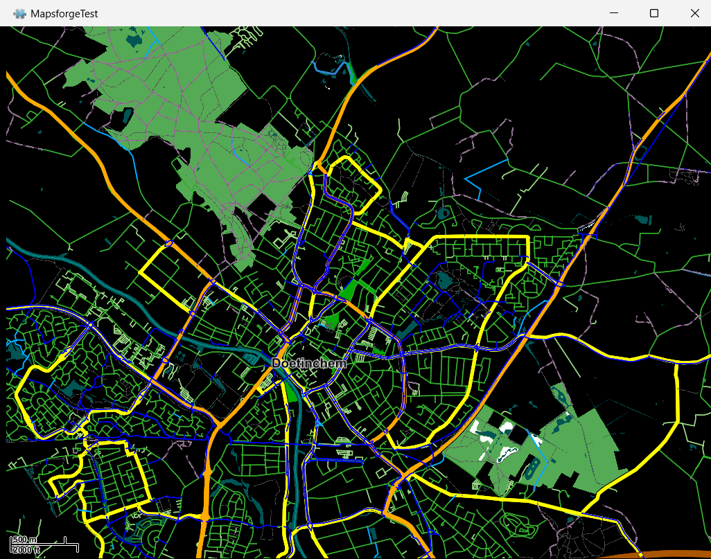

# WahooMapStyles

A place to share **Wahoo ELEMNT map styles** (`vtm-elemnt.xml`): make your map clearer, calmer or just prettier, and let others use it.

## Background

The look of the map on a Wahoo ELEMNT (colours, line widths, which features are shown) is controlled by a [VTM](https://github.com/mapsforge/vtm) render theme, not by the map tiles. By default the theme is bundled inside the firmware and is not visible on the device storage.

If you put a file at `maps/vtm-elemnt/vtm-elemnt.xml` on the device, it overrides the bundled style. Delete the file and the firmware default is used again, so experimenting is safe.

Typical complaints a custom style can fix: blue cycle paths that are far too thick, too much clutter, poor contrast in sunlight, or missing features.

More details (file formats, map tiles, theme structure, an example of thinning cycle paths) are in the [Map styling](https://github.com/bertt/WahooDesktop/blob/main/docs/MAPS.md#map-styling) section of the Wahoo Desktop docs. The override behaviour comes from the community project [wahoo-vtm-themer](https://github.com/BadmanBarista/wahoo-vtm-themer).

Which OSM tags and values the map tiles actually contain (and can therefore be matched in a style) is listed in [TAGS.md](TAGS.md).

> Most of this is reverse-engineered from the device, not official Wahoo documentation. Use at your own risk and keep the original file.

## Default styles per firmware

Unmodified copies of the styles bundled in the firmware, to use as a starting point:

| Firmware (BoltApp build) | Folder | Files |
| ------------------------ | ------ | ----- |
| 18001 (BOLT2, firmware 180.01) | [`styles/18001/default`](styles/18001/default) | [`vtm-elemnt.xml`](styles/18001/default/vtm-elemnt.xml), `vtm-elemnt-enhanced.xml` (extra area fills such as golf courses and schools), `rendertheme.xsd` (XML schema) |

The 18001 files originate from [WahooDesktop](https://github.com/bertt/WahooDesktop/blob/main/docs/styles/18001/vtm-elemnt/vtm-elemnt.xml). Other firmware versions may ship a different default style. If you have the default style of another firmware number, please add it as `styles/<firmware>/default/`.

## Community styles

Community styles live in `styles/<username>/<style-name>/` and each contains a `vtm-elemnt.xml` and/or a `vtm-elemnt-enhanced.xml` (the variant with extra area fills such as golf courses and schools), ideally with a short `README.md` and a screenshot.

| Style | Author | Description |
| ----- | ------ | ----------- |
| *No styles yet, be the first!* | | |

### Featured styles

Especially nice styles get an extra mention here. 🏆

*Nothing yet, be the first!*

## Using a style

1. Download the `vtm-elemnt.xml` (or `vtm-elemnt-enhanced.xml`) of the style you want (check that it works with your firmware).
2. Connect your ELEMNT over USB (MTP).
3. Create the folder `maps/vtm-elemnt/` on the device and copy the file there. Keep the file name as it is.
4. Restart the device.

To go back to the default: delete the file (or folder) and restart.

## Previewing a style on your desktop

You can test a style without a device by rendering a Mapsforge `.map` file with the VTM desktop viewer.



### Installation

Requirements: [Git](https://git-scm.com/) and a JDK (Java 17 or newer, tested with Temurin 25).

```
git clone --depth 1 https://github.com/mapsforge/vtm
cd vtm
```

The Android modules need the Android SDK, which you don't need here. Comment out these lines in `settings.gradle`:

```
//include ':vtm-android'
//include ':vtm-android-example'
//include ':vtm-android-mvt'
```

Then build the playground (the jar ends up in `vtm-playground/build/libs/`):

```
gradlew :vtm-playground:fatJar
```

`gradlew` is the Gradle Wrapper in the root of the cloned `vtm` repo, so you don't need to install Gradle yourself. The first run downloads Gradle automatically. On Windows use `gradlew.bat` (`.\gradlew.bat` in PowerShell); on Linux/macOS use `./gradlew`.

### Start

Pass the style first, then one or more `.map` files:

```
java -cp vtm-playground/build/libs/vtm-playground-master-SNAPSHOT-jar-with-dependencies.jar org.oscim.test.MapsforgeTest path/to/vtm-elemnt.xml path/to/map.map
```

- Drag to pan, scroll wheel to zoom.
- Edit the style and press **F5** to reload it.
- If the log shows `invalid resource: patterns/...png`, put the referenced `patterns/` folder next to the style file. Without it, pattern fills (forest, wetland) are not drawn.

## Contribute

Everyone is welcome, and sharing is encouraged!

- **Share your own style:** open a pull request that adds `styles/<your-username>/<your-style-name>/vtm-elemnt.xml` (and/or `vtm-elemnt-enhanced.xml`). Start from the default of your firmware, keep changes focused, and describe what you changed (a screenshot helps).
- **Report a problem with a style:** found something odd, such as cycle paths that are too thick, unreadable colours or missing roads? [Open an issue](../../issues) with the style name, device, firmware and ideally a screenshot.
- **Add a default for another firmware:** PRs with the bundled default of other firmware numbers are very welcome.

Beautiful and useful styles get a featured mention in this README.

## License

See [LICENSE](LICENSE).