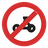
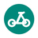

# vtm-elemnt-2026

A modern cycling map style for the Wahoo ELEMNT, written for the tags in `84.map`.

Style file: [vtm-elemnt-2026.xml](vtm-elemnt-2026.xml)

## Design choices

- **Bike-first emphasis.** Small paths you can ride are the stars of the map: cycleways, tracks and paths are drawn last (on top), in saturated colours with a thin halo so they stay visible on forest and grass. Their colour tells you the type: green for cycleways (so they are never confused with the blue of water), orange for tracks, red-orange dashes for paths, and purple when the path is explicitly open to bikes.
- **Surface hints through line style.** Solid lines are good surfaces; dashes get shorter as the surface gets softer (`tracktype` grade 1 to 5, unpaved cycleways).
- **Cars are in the background.** Roads are drawn first, thin, with a soft green outline and light colours. Motorways are grey and the least prominent.
- **No-cycling is explicit.** Motorways and any road with `bicycle=no` get red dashes and a repeated "no bikes" sign, so it is clear where you cannot ride.
- **Hiking paths stay visible.** Footways and paths that are not for bikes are brown and dotted, so they are readable but clearly different from bike routes.
- **Road bike facilities.** Cycle tracks and lanes along roads (`cycleway_track`, `cycleway_lane`) get a thin green line on the road, so a quiet bike-friendly road is easy to spot.
- **64 colours only.** The ELEMNT Bolt 2 display can only show 64 colours (4 levels per RGB channel: `00`, `55`, `AA`, `FF`), so every colour in this style is taken from that palette. See [wahoo_colors_64.md](../../wahoo_colors_64.md) for all 64 colours.
- **Solid colours instead of patterns.** Forest, wetland and other areas use flat light fills, so the style needs no external pattern images and renders cleanly on the small, sunlit screen.
- **Light and dark variants.** Every colour has a light and a dark counterpart (Bolt2, Bolt2 dark, Roam2 and Roam2 dark). Roam2 uses the same colours as Bolt2. The dark variant lowers the background brightness and lifts the bike colours so they keep their contrast.
- **Icons you can extend.** POIs such as drinking water, toilets, shelters, picnic spots, viewpoints, bike shops and rentals, and ferries have small icons in `symbols/`. Each POI is one style plus one rule, so new ones are easy to add. A coloured dot is drawn below every icon as a fallback.
- **Cycle and hiking nodes.** Cycle nodes (`cycle_node`) are shown as green dots with their number, and hiking nodes as brown dots.
- **Tunnels.** Underpasses for bikes and walkers are shown dashed. Road tunnels are hidden.
- **Same menu as the original.** The style menu (Bolt2, Roam2, light, dark, TF) is kept, so the device can switch layers as before. The TrailForks layers are empty in this style.

Colours below are given for the light and the dark variant.

## Legend

Rename `vtm-elemnt-2026.xml` to `vtm-elemnt.xml` to use it on the device, and keep the `symbols/` folder next to it. Without the icons you still see a coloured dot at each POI.

## Bike and hiking paths (top of the stack)

| Feature | Line | Light | Dark | OSM tags |
| ------- | ---- | ----- | ---- | -------- |
| Cycleway (paved) | thick solid, white/dark halo | `#00AA00` | `#55FF55` | `highway=cycleway` |
| Cycleway (unpaved) | thick dashed | `#00AA00` | `#55FF55` | `highway=cycleway` + `surface=raw/gravel/unpaved/compacted/rough_paved` |
| Track, good surface | solid | `#AA5500` | `#FFAA00` | `highway=track` + `tracktype=grade1/2` |
| Track, grade 3 or unknown | long dashes | `#AA5500` | `#FFAA00` | `highway=track` + `tracktype=grade3/none` |
| Track, soft surface | short dashes | `#AA5500` | `#FFAA00` | `highway=track` + `tracktype=grade4/5` |
| Path (rideable by default) | dashed | `#FF5500` | `#FF5500` | `highway=path` |
| Path or footway with bicycle allowed | dashed | `#AA00FF` | `#AA55FF` | `bicycle=yes/designated/permissive` |
| Hiking path | dotted | `#550000` | `#FFAA55` | `highway=footway/pedestrian`, `highway=path` with `bicycle=no` or `foot=designated` |
| Bridleway | fine dots | `#555500` | `#AA5500` | `highway=bridleway` |
| Steps | tiny dashes | `#555555` | `#AAAAAA` | `highway=steps` |
| Path in a tunnel | same colour, dashed `3,3` | | | `tunnel=yes` |

## Cycle facilities on roads

| Feature | Line | Light | Dark | OSM tags |
| ------- | ---- | ----- | ---- | -------- |
| Separate bike track along a road | thin line on the road | `#00AA00` | `#55FF55` | `cycleway_track=*` |
| Bike lane on a road | thin dashed line on the road | `#00AA00` | `#AAFFAA` | `cycleway_lane=*` |

## No cycling

| Feature | Marking | Light | Dark | OSM tags |
| ------- | ------- | ----- | ---- | -------- |
| Motorway | red dashes +  sign | `#FF0000` | `#FF5555` | `highway=motorway/motorway_link` |
| Any road with bicycle=no | red dashes + sign | `#FF0000` | `#FF5555` | `bicycle=bic_no` on roads |

## Roads (muted, below the bike layer)

| Road | Light | Dark |
| ---- | ----- | ---- |
| Motorway | `#AAAAAA` | `#555555` |
| Trunk | `#FFAA00` | `#AA5500` |
| Primary | `#FFAA55` | `#AA5500` |
| Secondary | `#FFFF55` | `#555500` |
| Tertiary | `#FFFFAA` | `#555555` |
| Residential, living street, unclassified | `#FFFFFF` | `#55AA55` |
| Service | `#FFFFFF` | `#55AA55` |

Roads have a thin outline (`#55AA55` green light, `#000000` dark). Railways are grey with light ticks; trams are thin grey.

## Icons (points of interest)

| Icon | Meaning | OSM tags | From zoom |
| ---- | ------- | -------- | --------- |
|  | Drinking water | `amenity=drinking_water/water_point`, `drinking_water=yes` | 10 / 13 |
|  | Toilets | `amenity=toilets` | 15 |
|  | Shelter | `amenity=shelter` | 14 |
|  | Picnic | `leisure=picnic_table`, `tourism=picnic_site` | 15 / 14 |
|  | Viewpoint | `tourism=viewpoint` | 14 |
|  | Bike shop | `shop=bicycle` | 13 |
|  | Bike rental | `amenity=bicycle_rental` | 14 |
|  | Ferry terminal | `amenity=ferry_terminal` | 14 |
| green dot with number | Cycle node (knooppunt) | `cycle_node=NLBE`, number from `ref` | 12 |
| brown dot | Hiking node | `hike_node=rwn` | 13 |
| small brown dot | Gate, bollard, cycle barrier | `barrier=gate/lift_gate/bollard/cycle_barrier/chain/block` | 16 |
| small orange dot | Stile, turnstile, kissing gate | `barrier=stile/turnstile/kissing_gate` | 16 |
| dark dot with name | Train station | `railway=station/halt` | 13 |

Drinking water is rare in the map data. Only a handful of points exist in `84.map`, so zoom in near villages and towns to find them.

### Adding an icon

1. Put a PNG (48x48) in `symbols/`.
2. Add `<style-symbol id="poi-xyz" src="symbols/xyz.png" symbol-width="22"/>`.
3. Copy an existing POI rule in the POI region and change the `k`/`v` tags, zoom and symbol id.

## Land, water and places

| Feature | Light | Dark |
| ------- | ----- | ---- |
| Background | `#FFFFFF` | `#000000` |
| Water, canals, rivers | `#AAFFFF` | `#000055` |
| Streams, drains | `#00AAFF` | `#0055FF` |
| Ferry route (dashed) | `#0055FF` | `#00AAFF` |
| Forest and scrub | `#AAFFAA` / `#AAFFAA` | `#005500` / `#005500` |
| Grass, meadow | `#FFFFFF` | `#000000` |
| Park, garden, golf | `#AAFFAA` | `#005500` |
| Heath, grassland | `#FFFFAA` | `#555500` |
| Sand, beach | `#FFFFAA` | `#555500` |
| Wetland | `#AAFFFF` | `#005555` |
| Nature reserve | `#FFFFFF` | `#000000` |
| Cemetery | `#AAFFAA` | `#005500` |
| Pedestrian area | `#FFFFFF` | `#000000` |

Place names (city, town, village, suburb, hamlet, locality) and peaks are shown as captions.
